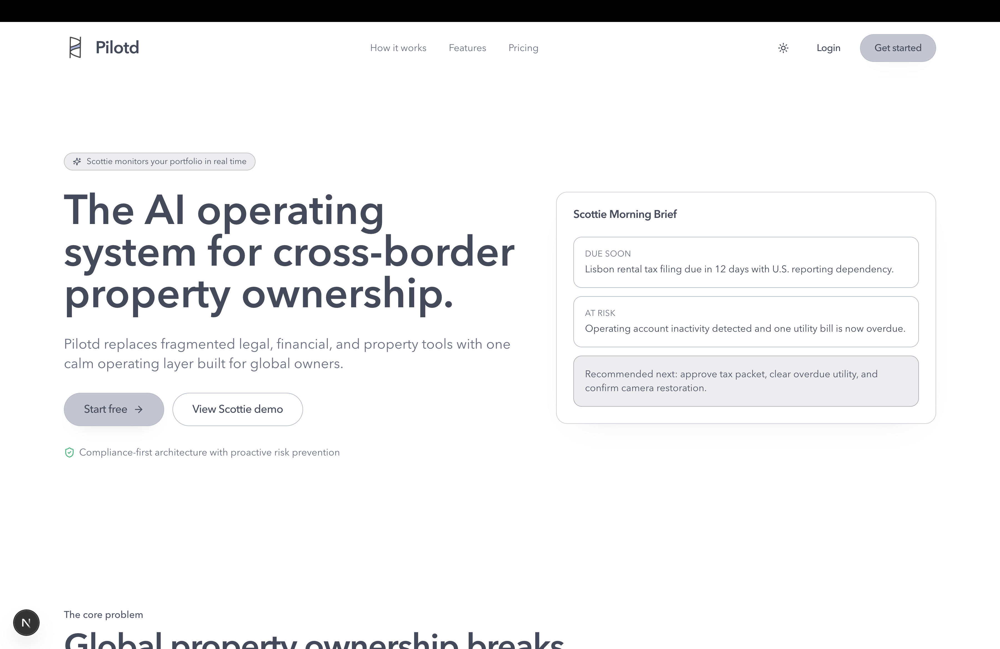

# Pilotd

### The AI operating system for cross-border property ownership.

Pilotd gives global property owners one calm command center for compliance, finances, banking risk, maintenance, and smart-property incidents. Its AI assistant, **Scottie**, turns fragmented portfolio signals into concise briefs and clear next actions.



## Why Pilotd

Owning property across countries means juggling local filing deadlines, operating accounts, utility payments, vendors, and smart devices across disconnected systems. Pilotd brings those workflows together so owners can spot risk early and act with confidence.

## What it does

- **Cross-border compliance** — track jurisdiction-specific deadlines and reporting dependencies.
- **Financial operations** — surface overdue bills, payment continuity issues, and dormant-account risk.
- **Property monitoring** — follow maintenance, HVAC, security camera, and smart-device incidents.
- **AI portfolio intelligence** — receive prioritized summaries and recommended actions from Scottie.
- **Unified portfolio view** — manage properties, alerts, activity, and settings from one dashboard.

## Tech stack

- Next.js 15 App Router and React 19
- TypeScript and Tailwind CSS
- Supabase PostgreSQL and Auth
- Framer Motion and Radix UI primitives
- Server Actions and Next.js route handlers

## Run locally

### Prerequisites

- Node.js 20+
- npm

### Setup

```bash
git clone https://github.com/Hitayu12/pilotd.git
cd pilotd
npm install
cp .env.example .env.local
npm run dev
```

Open [http://localhost:3000](http://localhost:3000).

Pilotd automatically uses its built-in demo data when Supabase credentials are absent, so you can explore the product immediately. To enable authentication and live persistence, add the following values to `.env.local`:

```env
NEXT_PUBLIC_APP_URL=http://localhost:3000
NEXT_PUBLIC_SUPABASE_URL=https://your-project-id.supabase.co
NEXT_PUBLIC_SUPABASE_ANON_KEY=your-anon-key
```

## Demo experience

The included scenario follows a U.S.-based owner with properties in Lisbon, Mumbai, and Austin. It demonstrates:

- a Lisbon tax filing approaching its deadline;
- operating-account dormancy risk;
- an overdue utility bill;
- HVAC and camera incidents; and
- Scottie-generated summaries and next actions.

## Project structure

```text
app/                    Routes, server actions, and API handlers
components/             Marketing, dashboard, Scottie, and UI components
lib/                    Data access, authentication, utilities, and AI logic
supabase/migrations/    Database schema and auth profile trigger
supabase/seed.sql       Demo portfolio data
types/                  Shared TypeScript domain types
```

## Useful commands

```bash
npm run dev        # Start the development server
npm run build      # Create a production build
npm run typecheck  # Run TypeScript checks
```

## Supabase setup

For a connected environment, run these files in the Supabase SQL Editor in order:

1. `supabase/migrations/202603070001_init.sql`
2. `supabase/migrations/202603070002_auth_profile_trigger.sql`
3. `supabase/seed.sql`

Then configure the Email provider and add `http://localhost:3000/app` as an allowed redirect URL.

## AI integration

Scottie currently uses a deterministic demo engine in `lib/ai/scottie.ts`. The `/api/scottie` contract is intentionally model-agnostic, making it straightforward to connect a production LLM while preserving the existing UI and portfolio context flow.

---

Built to make global property ownership feel local, legible, and under control.
